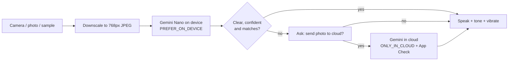

# TapSafe

> Hear the amount on a card terminal before you tap. Built for blind and low-vision shoppers.

**Hackathon:** #BuildHybridAI 2026 (Firebase AI Logic) · **Platform:** Web / Chrome · **Demo video:** _todo_ · **Live app:** https://sample-firebase-ai-app-cd689.web.app

## The problem
Card terminals show the amount on a small screen and expect you to tap. A blind shopper can't read it, so they have to trust whoever is holding the terminal. An extra zero (₹1,800 instead of ₹180), a tip added without asking, or a "refund" screen that's really a sale all look the same to someone who can't see the screen.

## What it does
1. Enter what you expect to pay, or **photograph the printed bill**. A larger cloud model itemises it, then TapSafe re-adds every line itself, flags service charges, duplicate items and tips already included, and sets the expected amount from the verified total.
2. Point the camera at the terminal. **Gemini Nano reads the screen on your device**: amount, currency, shop name, and what kind of screen it is (sale, refund, tip prompt, PIN entry, approved, declined).
3. TapSafe speaks the result and plays a distinct sound and vibration: two rising notes for "matches, safe to tap", three low pulses for "stop".
4. If the on-device read is unclear, or the amount doesn't match what you expected, TapSafe **asks before sending the photo to the cloud** for a second opinion from a larger Gemini model. Nothing leaves the device without consent unless you turn that on.
5. Every result shows which model answered and how long it took.
6. If the terminal asks for the wrong amount, TapSafe can **write a short note for the shop manager or card issuer**. Only the amounts, shop name and time go to the cloud, never the photo.

## Why hybrid
| | On-device (Gemini Nano in Chrome) | Cloud (Gemini via Firebase AI Logic) |
|---|---|---|
| When | Every scan, first | Only when the device read is unclear or disagrees with you, and you say yes |
| Why | Instant, works offline, the photo never leaves the phone | Better at glare, odd angles and unusual fonts |
| Cost | Free | Paid per call, so we only use it when it changes the answer |

Jobs that never fit on the device go straight to a larger cloud model (`VITE_CLOUD_PRO_MODEL`, default `gemini-3.5-flash`):

| Job | Why not on-device | What's sent |
|---|---|---|
| Itemise a long bill | Gemini Nano in Chrome is single-turn with a ~9k-token budget; dense bills need a bigger model | Bill photo, after the user chooses to photograph it |
| Dispute note | Free-form writing; quality matters more than speed | Amounts, shop name, time. No image |

If the larger model returns 5xx, TapSafe retries once and then falls back to the everyday cloud model, so the user always gets an answer.

The cloud check also guards against a false alarm: before telling someone "Stop, this is wrong" at a till, TapSafe can confirm the mismatch with the bigger model.

## Firebase features used
| Feature | Where | What it does here |
|---|---|---|
| Firebase AI Logic hybrid inference (`InferenceMode.PREFER_ON_DEVICE`) | `src/lib/firebase.ts` | Every scan runs on Gemini Nano first, with automatic cloud fallback when Nano isn't available |
| `InferenceMode.ONLY_IN_CLOUD` second model | `src/lib/firebase.ts`, `src/lib/reader.ts` | Consent-gated second opinion |
| `response.inferenceSource` | `src/lib/reader.ts` | Shows the user which model answered |
| On-device structured output (`responseConstraint`) and cloud `responseJsonSchema` | `src/lib/schema.ts` | Same JSON schema on both paths, so the app logic doesn't care which model ran |
| `initializeDeviceModel()` with progress | `src/lib/reader.ts` | In-app Gemini Nano download |
| Larger cloud model (`billModel`, `letterModel`) with JSON schema and thinking level per job | `src/lib/firebase.ts`, `src/lib/reader.ts` | Bill itemising (low thinking, transcription) and dispute notes (minimal thinking, short output) |
| App Check (reCAPTCHA Enterprise) | `src/lib/firebase.ts` | Protects the cloud endpoint |
| Firebase Hosting | `firebase.json` | Live app |

## Architecture


## Claims and evidence
| Claim | Evidence |
|---|---|
| Amount comparison is exact to the paisa and handles ₹1,250.00 / 1.250,00 € / Rs. 450 | `src/lib/amount.test.ts` |
| Unclear, low-confidence or mismatching device reads escalate; cloud reads never re-escalate | `src/lib/amount.test.ts` (`needsSecondOpinion`) |
| Bill totals are never trusted from the model alone: lines are re-added in code, with a 1-unit round-off tolerance | `src/lib/bill.test.ts` |
| Discounts are subtracted whether or not the model kept the minus sign; duplicate items and pre-added tips are flagged | `src/lib/bill.test.ts` |
| The dispute-note prompt contains only extracted facts, never image data | `src/lib/bill.test.ts` (`letterPrompt`) |
| No photo is sent to the cloud without consent (unless the user turns on auto-send) | `src/App.tsx` consent step; video _todo_ |
| Works offline on device | video _todo_ |

## Run it
Needs **Google Chrome on desktop**, version 139 or later, for on-device Gemini Nano (Brave and other Chromium browsers don't ship Nano).

```bash
cp .env.example .env.local   # add your Firebase web config (test project)
npm install
npm run dev                  # http://localhost:5173
npm test                     # unit tests
```

No terminal nearby? Open "Try a sample screen" for six synthetic terminals: correct amount, overcharge, pharmacy, refund, tip prompt and glare.

## Built during the hackathon
All code was written after the submission period opened (11 Nov 2026). Scaffolded with Vite's React template.

## What's next
- Android app with Gemini Nano 4 (camera-first, works in a shop without signal).
- Live mode: read continuously and speak only when the amount changes.
- Hindi and other Indian languages for the spoken result.

## Team
- Moksh Upadhyay
- Vivek Verma
